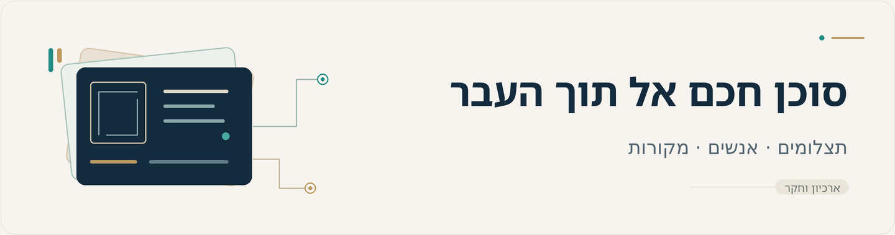
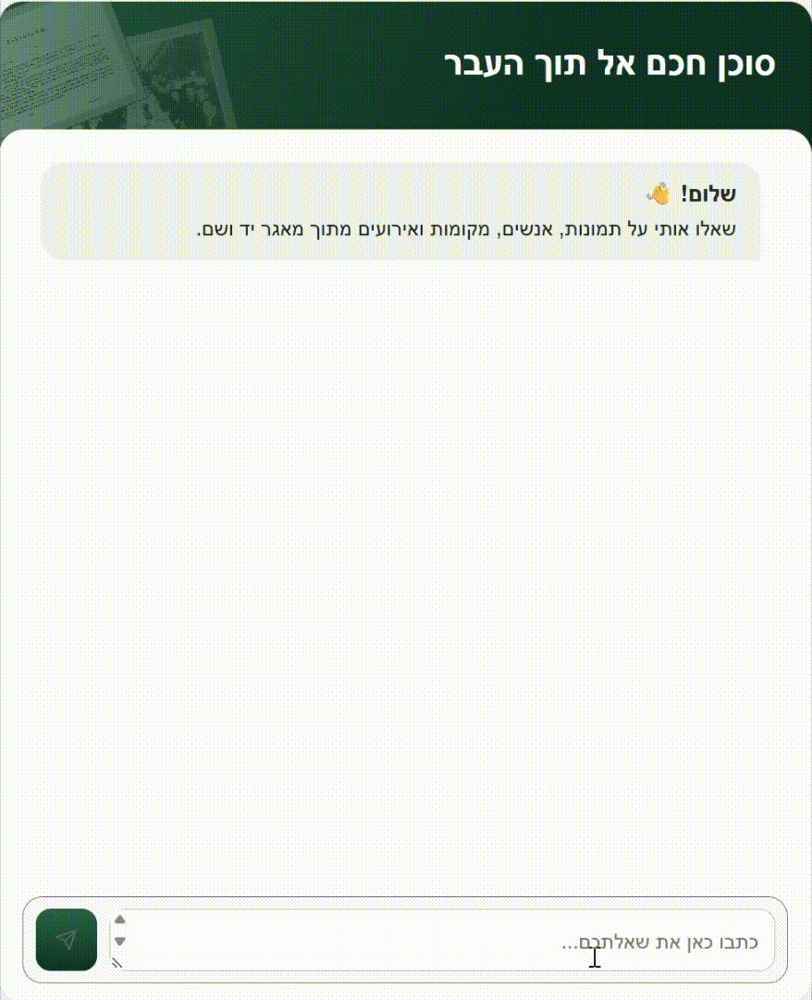
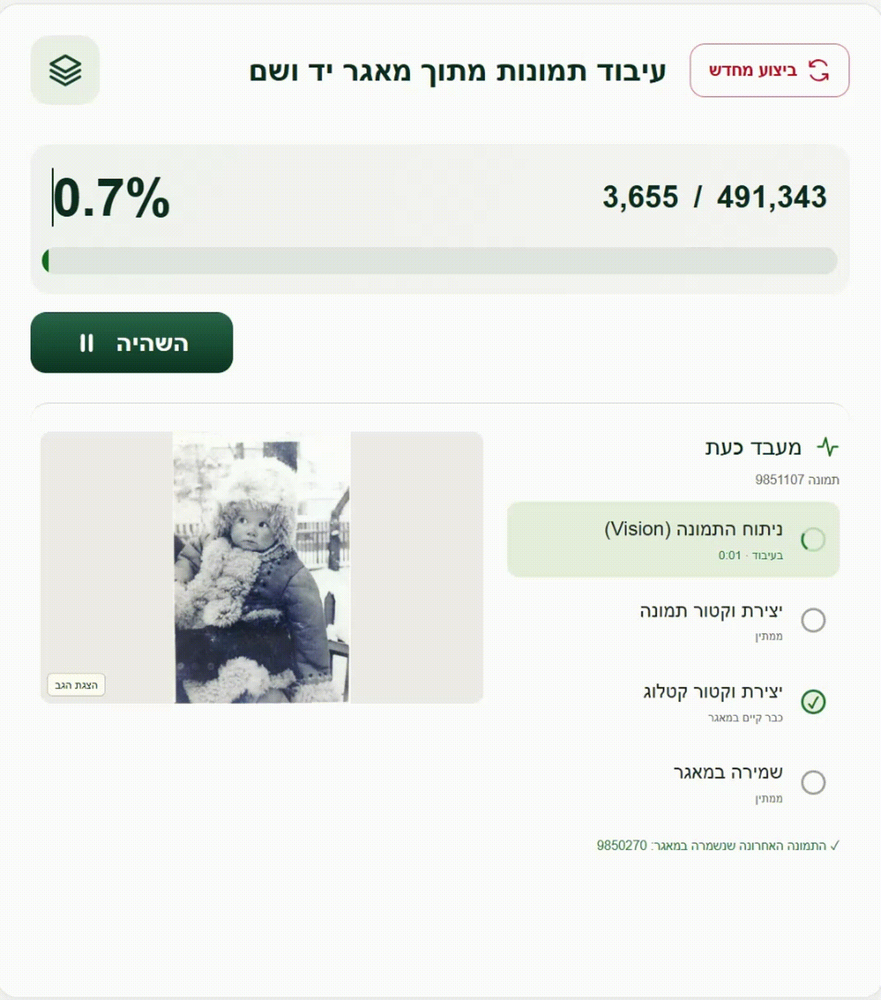
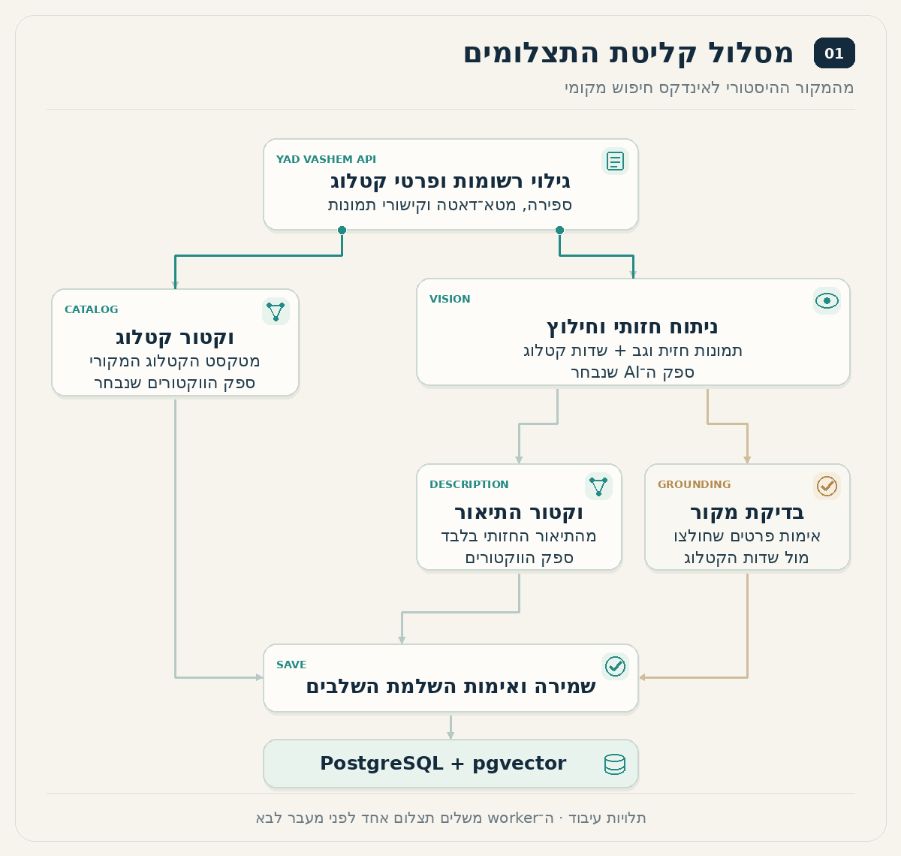
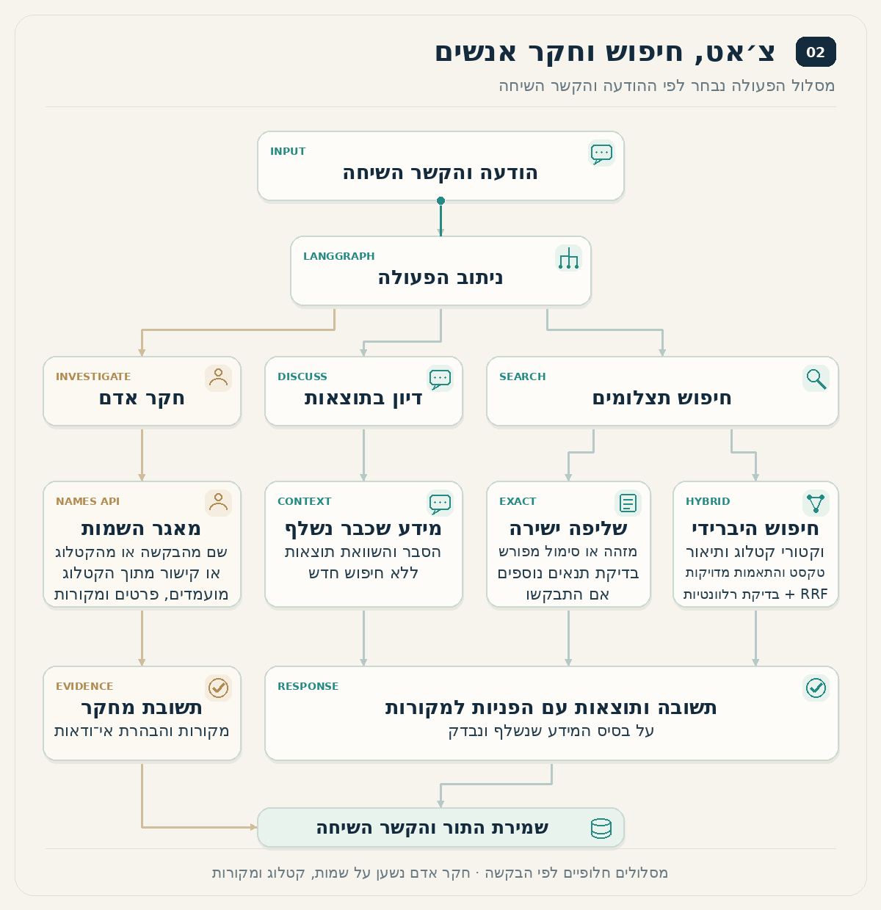

<div dir="rtl" align="right">

<p align="center">
  
</p>

<h1 align="center">חיפוש תצלומים וחקר אנשים בארכיון יד ושם</h1>

<p align="center">
  חיפוש בשפה טבעית, הבנת תמונות וחקר אנשים — בשיחה שמפנה למקורות.
</p>

<!-- ממשק המערכת: תמונות תצוגה חתוכות ללא שוליים שחורים -->
<div align="center">
  <h3>✨ הצצה למערכת בפעולה</h3>
  <table>
    <tr>
      <th align="center" width="50%">💬 סוכן חכם אל תוך העבר</th>
      <th align="center" width="50%">🖼️ עיבוד תמונות מתוך מאגר יד ושם</th>
    </tr>
    <tr>
      <td align="center" valign="top">
        <a href="docs/assets/readme/ui-chat.gif">
          
        </a>
      </td>
      <td align="center" valign="top">
        <a href="docs/assets/readme/ui-ingestion.gif">
          
        </a>
      </td>
    </tr>
  </table>
</div>

<p align="center" dir="ltr">
  <code>Next.js</code> · <code>FastAPI</code> · <code>LangGraph</code> · <code>PostgreSQL + pgvector</code><br>
  <code>Ollama</code> · <code>OpenAI</code> · <code>OpenRouter</code> · <code>Docker Compose</code>
</p>

<p align="center">
  <a href="#overview">יכולות</a> ·
  <a href="#quick-start">התחלה מהירה</a> ·
  <a href="#usage">שימוש</a> ·
  <a href="#flows">תרשימים</a> ·
  <a href="#ai-providers">מודלים והגדרות</a> ·
  <a href="#operations">תפעול</a> ·
  <a href="#roadmap">מפת דרכים</a>
</p>

---

<a id="overview"></a>

## 🔎 מה אפשר לעשות?

אפליקציה מקומית בעברית לחיפוש בתצלומי יד ושם ולחקר אנשים במאגר השמות. המערכת משלבת קטלוג מקורי, תיאורים חזותיים שנוצרים באמצעות מודל וסוכן שיחה עם הפניות למקורות. הקליטה משתמשת באוסף האמיתי של יד ושם.

| יכולת | מה היא כוללת |
| ---: | ---: |
| 🖼️ **חיפוש תצלומים** | חיפוש בשפה טבעית בקטלוג ובתיאור החזותי; שליפה לפי מזהה או סימול. |
| 👤 **חקר אנשים** | חיפוש לפי שם מלא, שם פרטי או שם משפחה; מועמדים, פרטים ומקורות ממאגר השמות. |
| 💬 **שיחה עם הקשר** | שאלות המשך, השוואת תוצאות, מיקוד בתצלום ומעבר מתצלום לחקר אדם. |
| ⚙️ **קליטה מתמשכת** | קטלוג ותמונות חזית וגב, כשזמינות; ניתוח Vision, יצירת וקטורים, השהיה והמשך. |
| 🧠 **בחירת מודלים** | Ollama מקומי, OpenAI או OpenRouter; בחירה נפרדת לספק הצ׳אט וה־Vision ולספק הווקטורים. |
| 🗂️ **אינדקס מקומי** | וקטורים נפרדים לקטלוג ולתיאור החזותי, לצד חיפוש טקסטואלי ואיחוד דירוגים. |
| 🧪 **כלי פיתוח ואימות** | לוגים מובנים, בדיקות אוטומטיות ובדיקות מודל יזומות מצומצמות. |

### תמונת מצב של הקליטה

| רשומות שהושלמו | סך הרשומות שדווח | התקדמות | תאריך העדכון |
| ---: | ---: | ---: | ---: |
| **3,487** | **491,343** | **0.7%** | **15.11.2026** |

זהו נתון ידני שאינו מתעדכן אוטומטית במסמך. רשומה נספרת כהושלמה רק לאחר שכל התמונות שלה עברו את שלבי העיבוד והשמירה. הממשק מציג בזמן ההפעלה את ההתקדמות העדכנית מול הסך שמדווח המקור.


<a id="quick-start"></a>

## 🚀 התחלה מהירה

הפקודות במסמך מיועדות להרצה ב־PowerShell, מתיקיית השורש של הפרויקט.

> **מסד נתונים מהגרסה הישנה?** לפני הפעלת הגרסה הנוכחית, עברו על [המעבר ל־baseline](#database-baseline). ההפעלה הרגילה מיועדת להתקנה חדשה או למסד שכבר תואם לגרסה הנוכחית.

### 1. הכנת הסביבה

- התקינו והפעילו **Docker Desktop** במצב Linux containers.
- נדרש חיבור לאינטרנט לאוספי יד ושם, לספקי API שנבחרו ולהורדת מודלים מקומיים.
- בתצורת ברירת המחדל, התקינו והפעילו **Ollama על מחשב Windows המארח**. בשימוש בספקי API לכל הפעולות אין צורך ב־Ollama.

הורידו את מודלי ברירת המחדל, אם אינם מותקנים:

<div dir="ltr" align="left">

```powershell
ollama pull qwen3.8:latest
ollama pull qwen3-embedding:latest
ollama list
```

</div>

מודל `qwen3.8:latest` משמש לצ׳אט ול־Vision, ו־`qwen3-embedding:latest` לווקטורים. אפשר לבחור [ספקים ומודלים אחרים](#ai-providers).

### 2. הגדרת הסביבה והפעלת השירותים

פקודת ההעתקה הבאה שומרת על קובץ `.env` קיים:

<div dir="ltr" align="left">

```powershell
if (!(Test-Path .env)) { Copy-Item .env.example .env }
```

</div>

לשימוש בספקי API, ערכו את `.env` לפי [אפשרויות התצורה](#ai-providers) לפני ההפעלה. לברירת המחדל המקומית:

**קיבלתם גיבוי ממחשב אחר?** אחרי יצירת `.env` ולפני ההפעלה הראשונה, בצעו [שחזור מסד נתונים](#database-transfer). כך תקבלו את הרשומות, התיאורים והווקטורים שכבר עובדו, במקום להתחיל במסד ריק.

<div dir="ltr" align="left">

```powershell
docker compose up -d --build --wait
Invoke-RestMethod http://127.0.0.1:3030/api/health
Invoke-RestMethod http://127.0.0.1:3030/api/health/ai
```

</div>

בדקו שהשדות `reachable` ו־`ready` הם `true`. השדות `provider` ו־`embedding_provider` מציגים את הספקים הפעילים.

בדיקת ה־AI מאמתת חיבור והופעת שמות המודלים בקטלוג הספק. היא אינה מבצעת יצירת תוכן ואינה מבטיחה הרשאות שימוש, מכסה או תמיכה בכל יכולות המודל. בזמן המשך קליטה נבדקים גם ממדי הווקטורים.

### 3. פתיחת האפליקציה

| יעד | כתובת |
| ---: | ---: |
| 💬 ממשק האפליקציה | <span dir="ltr">[http://127.0.0.1:3030](http://127.0.0.1:3030)</span> |
| 🗄️ pgAdmin | <span dir="ltr">[http://127.0.0.1:5050](http://127.0.0.1:5050)</span> — [פרטי כניסה וחיבור](#browse-the-database) |

בהתקנה חדשה הקליטה מתחילה במצב מושהה. לחצו **המשך** כדי להתחיל לעבד את האוסף.

<a id="usage"></a>

## 💬 שימוש במערכת

הממשק מציג צ׳אט מימין ותהליך קליטה רציף משמאל. יש תהליך קליטה יחיד, ללא טופסי מזהה בודד או טווח, רשימות משימות, פעולת עצירה נפרדת או משימות ניסיון חוזר נפרדות.

### שליטה בקליטה

| פעולה | התנהגות |
| ---: | ---: |
| ▶️ **המשך** | מתחיל או ממשיך את הקליטה, ומנסה שוב שלבים שנכשלו או נחסמו באותו תהליך. |
| ⏸️ **השהיה** | משהה לאחר סיום השלב הנוכחי. ההתקדמות, עמוד המקור והשלבים שהושלמו נשמרים. |
| 🔄 **ביצוע מחדש** | לאחר אישור, מוחק תיאורים שנוצרו, חילוצי קטלוג, שני אינדקסי הווקטורים, התור והיסטוריית הניסיונות הקודמים, ומתחיל עיבוד מחדש. רשומות המקור והפניות לתמונות נשמרות. |

בביצוע מחדש, השלב הפעיל מסיים ותוצאתו הישנה נזרקת לפני החלפת התהליך. נשמרת רשומת תהליך יחידה. תוכן שכבר אונדקס נשמר עד לאישור מפורש של ביצוע מחדש.

כרטיס ההתקדמות מציג רשומות שנשמרו במלואן, סך רשומות ואחוזים. לצד התצלום הנוכחי מופיעים ניתוח Vision, יצירת וקטור חזותי, יצירת וקטור קטלוג ושמירה. כשסך הרשומות אינו ידוע מוצג מקף. שגיאה נספרת פעם אחת לכל רשומה; שלב שמירה שממתין לניתוח שנכשל מסומן כחסום, ולא ככשל נוסף. תמונות חסרות וכשלי מקור או מודל אינם מסומנים כהשלמה.

### דוגמאות לשיחה

| מטרה | דוגמה |
| ---: | ---: |
| חיפוש תיאורי | „מצא תצלום חתונה בפולין לפני 1939” |
| מיקוד תוצאות | „רק כאלה שמופיעים בהם ילדים” |
| מסמך או סימול | „מסמך בגרמנית” · „הצג סימול 6256/3” |
| חיפוש אדם | „חפש את יהודה הרשקוביץ” · „חפש לפי שם משפחה כהן” |
| מתצלום לאדם | „מי האדם בתמונה הראשונה?” |
| המשך חקירה | „בחר את המועמד השני” · „הצג עוד מועמדים” · „הצג עוד מקורות” · „רענן את המקורות” |
| מאדם לתצלומים | „מצא תצלומים של יהודה הרשקוביץ” — חיפוש לפי שם באינדקס המקומי. |

חיפוש תצלומים לפי תוכן נשען על התמונות שכבר נשמרו באינדקס המקומי. חיפוש אדם לפי שם פונה ישירות למאגר השמות ויכול לעבוד גם לפני קליטת תצלומים.

**שיחה חדשה** פותחת שיחה חדשה לאחר תור. גם רענון הדף מתחיל שיחה חדשה; אין כרגע ממשק או נקודת קצה לפתיחה מחדש של שיחות שמורות. המערכת מיועדת להפעלה מקומית, ללא חשבונות או התחברות.

> **זהות ומקורות:** המערכת אינה מזהה פנים. התאמה בשם, גם כשיש מועמד יחיד או כשמשתמש בחר בו, אינה אימות של זהות המצולם. הקשר בין אדם לתצלום נשען על הקטלוג והמקורות הזמינים; מידע לא נתמך מוצג כלא ידוע.

<a id="flows"></a>

## 🧭 איך המערכת עובדת?

### קליטת תצלומים

<p align="center">
  
</p>

<p align="center"><a href="docs/assets/readme/ingestion-flow.png">צפייה בתרשים ללא הנפשה</a></p>

התהליך מגלה רשומות ב־API של יד ושם ושולף קטלוג וקישורי תמונות. טקסט הקטלוג המקורי נשלח ליצירת וקטור קטלוג. תמונות החזית והגב, יחד עם שדות הקטלוג, נשלחות לניתוח Vision שמפריד בין תיאור חזותי לחילוץ פרטים מהקטלוג. מהתיאור בלבד נוצר הווקטור החזותי; החילוץ נבדק מול שדות המקור. לאחר שמירה ובדיקת השלמת השלבים, התמונה זמינה לחיפוש.

התרשים מתאר **תלויות בין שלבים**. ה־worker מסיים לטפל בתצלום לפני שהוא עובר לתצלום הבא. נקודות התקדמות ותוצרים תקפים נשמרים כדי להימנע מעיבוד חוזר. תמונות מעובדות בזיכרון ומוצגות בממשק מכתובות המקור.

### צ׳אט, שליפה וחקר אנשים

<p align="center">
  
</p>

<p align="center"><a href="docs/assets/readme/agent-flow.png">צפייה בתרשים ללא הנפשה</a></p>

| פעולה | תפקיד |
| ---: | ---: |
| `search` — חיפוש תצלומים | ניסוח שאילתה מלאה לפי ההקשר; חיפוש סמנטי בקטלוג ובתיאור החזותי, חיפוש טקסטואלי והתאמות מדויקות; שליפה ישירה לפי מזהה או סימול. |
| `discuss` — דיון בתוצאות | הסבר, השוואה, מיקוד בתצלום ושאלות הבהרה על סמך המידע שכבר נשלף, ללא חיפוש חדש. |
| `investigate` — חקר אדם | `search_people` לחיפוש בשם ו־`get_person_details` לפרטים ומקורות; צמצום מועמדים, בחירה, מקורות נוספים ורענון. |

**דירוג התוצאות:** דירוגי ערוצי השליפה משולבים באמצעות RRF. עד 20 מועמדים עוברים בדיקת רלוונטיות מול ראיות מהקטלוג ומהתיאור החזותי. רק אחריה מוחלים מספר התוצאות וסף הדירוג: כברירת מחדל, עד 5 תוצאות ובסף של 85% מדירוג התוצאה הטובה ביותר שאושרה. זהו דירוג יחסי, לא הסתברות לנכונות.

בחיפוש תיאורי אין מסנני SQL ייעודיים למקום או לשנה; התנאים נכללים בשאילתה ובבדיקת הראיות. אם embeddings אינם זמינים, המערכת מנסה חיפוש טקסטואלי ומודיעה על כך. אם בדיקת הרלוונטיות נכשלת, תוצאות שלא נבדקו אינן מוצגות. דיון בתצלום קיים משתמש במידע השמור, ללא ניתוח מחדש של הפיקסלים בכל תור.

<a id="ai-providers"></a>

## 🧠 מודלים והגדרות סביבה

ערכו את ההגדרות בקובץ `.env` שנוצר מתוך [`.env.example`](.env.example), בלי ליצור כמה הגדרות לאותו משתנה. בחירת `AI_PROVIDER` משותפת לצ׳אט ול־Vision; בחירת `EMBEDDING_PROVIDER` עצמאית.

| הגדרה | תפקיד |
| ---: | ---: |
| `AI_PROVIDER` | ספק הצ׳אט וה־Vision:‏ `ollama`,‏ `openai` או `openrouter`. ברירת מחדל: `ollama`. |
| `EMBEDDING_PROVIDER` | ספק הווקטורים, עם אותן שלוש אפשרויות. ברירת מחדל: `ollama`, גם כשנבחר API לצ׳אט. |
| `CHAT_MODEL`,‏ `VISION_MODEL` | מזהי המודלים אצל ספק ה־AI שנבחר. |
| `EMBEDDING_MODEL`,‏ `EMBEDDING_DIMENSIONS` | מודל הווקטורים וממדיו. ברירת המחדל היא 4,096 ממדים; נדרשת התאמה למודל ולסכמת המסד. |
| `OLLAMA_URL` | בתוך Docker Desktop:‏ `http://host.docker.internal:11434`. בהרצת Python ישירות ב־Windows:‏ `http://localhost:11434`. |
| `OPENAI_API_KEY`,‏ `OPENROUTER_API_KEY` | מפתח לכל ספק API שנבחר, גם אם הוא משמש רק לווקטורים. |
| `OPENAI_BASE_URL` | ברירת מחדל: `https://api.openai.com/v1`. |
| `OPENROUTER_BASE_URL` | ברירת מחדל: `https://openrouter.ai/api/v1`. |
| `API_TIMEOUT_SECONDS`,‏ `OLLAMA_TIMEOUT_SECONDS` | זמני ההמתנה ל־API ול־Ollama, בהתאמה. |
| `VISION_OUTPUT_TOKENS` | מגבלת פלט לניתוח תמונות: ברירת מחדל 5,200; טווח 512–8,192. |
| `API_MODEL_REVISION` | גרסה מקומית לזיהוי תוצרי API שמורים, למשל כשהספק מעדכן מודל תחת אותו שם. |

<details open>
<summary><strong>🖥️ אפשרות א׳ — Ollama לכל הפעולות</strong></summary>

זו תצורת ברירת המחדל:

<div dir="ltr" align="left">

```dotenv
AI_PROVIDER=ollama
EMBEDDING_PROVIDER=ollama
OLLAMA_URL=http://host.docker.internal:11434
CHAT_MODEL=qwen3.8:latest
VISION_MODEL=qwen3.8:latest
EMBEDDING_MODEL=qwen3-embedding:latest
EMBEDDING_DIMENSIONS=4096
```

</div>

</details>

<details>
<summary><strong>☁️ אפשרות ב׳ — OpenAI לצ׳אט ולתמונות, Ollama לווקטורים</strong></summary>

<div dir="ltr" align="left">

```dotenv
AI_PROVIDER=openai
OPENAI_API_KEY=your-openai-key
CHAT_MODEL=gpt-4.1-mini
VISION_MODEL=gpt-4.1-mini
EMBEDDING_PROVIDER=ollama
```

</div>

השאירו את `EMBEDDING_MODEL`,‏ `EMBEDDING_DIMENSIONS` ו־`OLLAMA_URL` בערכים המתאימים לאינדקס הקיים. Ollama עדיין נדרש לווקטורים.

</details>

<details>
<summary><strong>☁️ אפשרות ג׳ — OpenRouter לצ׳אט ולתמונות, Ollama לווקטורים</strong></summary>

<div dir="ltr" align="left">

```dotenv
AI_PROVIDER=openrouter
OPENROUTER_API_KEY=your-openrouter-key
CHAT_MODEL=openai/gpt-4.1-mini
VISION_MODEL=openai/gpt-4.1-mini
EMBEDDING_PROVIDER=ollama
```

</div>

גם כאן, השאירו את הגדרות הווקטורים וה־Ollama בהתאם לאינדקס הקיים.

</details>

<details>
<summary><strong>🔢 יצירת וקטורים דרך API</strong></summary>

לדוגמה, עם OpenAI:

<div dir="ltr" align="left">

```dotenv
EMBEDDING_PROVIDER=openai
OPENAI_API_KEY=your-openai-key
EMBEDDING_MODEL=text-embedding-3-small
EMBEDDING_DIMENSIONS=1536
```

</div>

ל־OpenRouter הגדירו `EMBEDDING_PROVIDER=openrouter`,‏ `OPENROUTER_API_KEY` ו־`EMBEDDING_MODEL=openai/text-embedding-3-small`, עם מספר הממדים המתאים. מודל הווקטורים שנבחר חייב לתמוך בפרמטר `dimensions` ולהחזיר את הגודל שהוגדר.

**החלפת ספק או מודל embeddings במאגר קיים דורשת בניית וקטורים מחדש, גם אם מספר הממדים זהה.** שינוי הממדים מחייב גם התאמת סכמה. עקבו אחר [תהליך החלפת מודל הווקטורים](#changing-embeddings) כדי לשמור על המאגר הקודם.

</details>

### תאימות מודלים וטעינת הגדרות

שמות מודלי ה־API בדוגמאות הם דוגמאות לבחירה, ואינם מוחלפים אוטומטית כשמשנים ספק. בחרו מודל זמין בחשבון עם תמיכה ב־JSON Schema structured outputs; מודל Vision חייב לתמוך גם בתמונות. המערכת מאמתת תשובות מול סכמות Pydantic. ב־OpenRouter נדרשת תמיכה בפרמטרים אצל הספק שאליו מנותבת הבקשה.

שני ספקי ה־API משתמשים במתאם HTTP תואם OpenAI עם התאמות אימות, כתובות, מגבלות טוקנים וניתוב. gateway חלופי חייב לתמוך באותן נקודות קצה וב־strict JSON Schema. התמיכה הישירה כוללת OpenAI ו־OpenRouter; אין מתאם Anthropic ישיר.

בהרצת Python, סדר הקדימות הוא **משתני הסביבה של התהליך, קובץ `.env`, ואז ברירות המחדל בקוד**. קובץ השורש נמצא גם בהרצה מתוך `backend/`. Compose טוען אותו ל־API ול־worker דרך `env_file`, מגדיר את מארח המסד כ־`postgres` וממפה את `POSTGRES_*` למשתני לקוח PostgreSQL. אפשר להעביר משתנה חד־פעמי דרך `docker compose run -e KEY=value` עם השירות והפקודה הרצויים.

המפתחות נדרשים בעת ההפעלה, נשארים בשרת ואינם מוחזרים דרך `/api/config`. הקובץ `.env` מוחרג מבקרת גרסאות. ספק API מקבל את הטקסטים והתמונות הדרושים לפעולות שהוקצו לו. כשלי API ממופים לקודי `ai_*`; גופי שגיאה של ספק ופרטי גישה אינם נרשמים ללוג.

לאחר שינוי `.env`, צרו מחדש את השירותים:

<div dir="ltr" align="left">

```powershell
docker compose up -d --build --wait
Invoke-RestMethod http://127.0.0.1:3030/api/health/ai
```

</div>

`docker compose restart` לבדו שומר את סביבת הקונטיינר הקודמת. לחזרה להפעלה מקומית מלאה, החזירו את שני הספקים ל־`ollama` ואת שמות המודלים המקומיים. הנתיב הישן `/api/health/ollama` נשאר ככינוי תאימות לבדיקת ה־AI.


<a id="operations"></a>

## 🛠️ תפעול ותחזוקה

המידע התפעולי מרוכז כאן בעברית. פתחו את הסעיף הדרוש:

- [מעבר מסד קיים ל־baseline](#database-baseline)
- [ייצוא ושחזור מסד במחשב אחר](#database-transfer)
- [החלפת מודל הווקטורים](#changing-embeddings)
- [צפייה במסד דרך pgAdmin](#browse-the-database)
- [תחזוקת פרומפטים](#prompt-maintenance)
- [גישה למקור, Vision ותיקון תמונות גב](#collection-access)

<a id="database-transfer"></a>

<details>
<summary><strong>📦 ייצוא ושחזור מסד במחשב אחר</strong></summary>

הסקריפטים נמצאים ב־`backend/db/`:‏ `export-db.ps1`,‏ `restore-db.ps1` וקובץ העזר `db-tools.ps1`. מסד הנתונים הפעיל עצמו נשמר ב־Docker volume בשם `postgres`, מחוץ לתיקיות הקוד; Git אינו מעביר אותו. הייצוא יוצר קובץ גיבוי נייד הכולל סכמה, רשומות מקור, הפניות לתמונות, תיאורים שנוצרו, שני אינדקסי הווקטורים, שיחות, התקדמות קליטה, תור והיסטוריית ניסיונות. אין צורך לעבד מחדש את המידע שכבר נשמר.

**דרישות:** Docker Desktop פועל, קובץ `.env` בכל מחשב ו־**PowerShell 7.3 ומעלה** (`pwsh`). הפקודות להלן מורצות משורש הפרויקט; הסקריפטים עצמם מאתרים את הפרויקט גם כשמפעילים אותם מתיקייה אחרת. נתיב גיבוי שמועבר כפרמטר יחסי נפתר ביחס לתיקיית העבודה של המפעיל.

### 1. ייצוא במחשב המקור

<div dir="ltr" align="left">

```powershell
pwsh -File .\backend\db\export-db.ps1
```

</div>

הסקריפט משהה את השירותים `api` ו־`worker` אם הם פועלים, יוצר גיבוי PostgreSQL דחוס בפורמט custom, בודק שניתן לקרוא את רשימת התוכן שלו ומעתיק אותו ישירות כקובץ בינארי. בסיום הוא מפעיל מחדש רק את השירותים שפעלו קודם, גם אם הייצוא נכשל. הוא אינו משנה את מצב הקליטה השמור במחשב המקור. בדיקת רשימת התוכן אינה שחזור ניסיון מלא.

ברירת המחדל היא קובץ בעל חותמת זמן בתיקיית `.backups/` שבשורש הפרויקט. קובצי `.dump` בתיקייה זו אינם מוחרגים מ־Git ומוגדרים ב־`.gitattributes` לשמירה באמצעות Git LFS; רק קובצי ייצוא זמניים (`*.partial`) מוחרגים. הפלט מציג את הנתיב המלא, SHA256, ספירות רשומות, גרסת סכמה, מודלי הווקטורים וממדיהם. אפשר לבחור יעד אחר; קובץ קיים לעולם אינו נדרס:

<div dir="ltr" align="left">

```powershell
pwsh -File .\backend\db\export-db.ps1 -OutputPath "C:\transfer\archive.dump"
```

</div>

### 2. העברה והכנת מחשב היעד

הגיבוי המצורף לפרויקט הוא `.backups/archive-20261115-172119-240.dump` (כ־166 MiB). הוא כולל 3,932 רשומות מקור, תיאורים, וקטורים, שיחות והתקדמות קליטה. GitHub חוסם קבצים רגילים הגדולים מ־100 MiB, ולכן גיבויי `.dump` בתיקיית `.backups/` מוגדרים ל־Git LFS. ראו [מגבלות גודל ב־GitHub](https://docs.github.com/en/repositories/working-with-files/managing-large-files/about-large-files-on-github).

**במחשב שמעלה את הפרויקט:** התקינו Git LFS. מתוך תיקיית repo שכבר אותחלה ב־Git, הפעילו אותו והוסיפו גם את הגיבוי וגם את קובץ התצורה ל־commit:

<div dir="ltr" align="left">

```powershell
git lfs install
git add .gitattributes .gitignore README.md .backups/archive-20261115-172119-240.dump
```

</div>

לאחר מכן בצעו commit ו־push עם שאר קובצי הפרויקט. Git LFS מעביר את תוכן הגיבוי בזמן ה־push. לייצוא עתידי, הוסיפו ל־commit את שם קובץ הגיבוי החדש שהסקריפט יצר.

**במחשב שמוריד את הפרויקט:** התקינו Git LFS והפעילו `git lfs install` לפני `git clone`. אחרי ההורדה, הריצו מתוך תיקיית הפרויקט:

<div dir="ltr" align="left">

```powershell
git lfs pull
```

</div>

הפקודה מורידה את תוכן הגיבוי המלא. הורדת ZIP של ה־repo עשויה לכלול רק קובץ הפניה קטן במקום הגיבוי; העדיפו clone עם Git LFS. עדיין אפשר להעביר את קובץ ה־`.dump` ישירות מחוץ ל־Git. התקינו Docker Desktop והכינו `.env`:

<div dir="ltr" align="left">

```powershell
if (!(Test-Path .env)) { Copy-Item .env.example .env }
```

</div>

התאימו ב־`.env` את `EMBEDDING_PROVIDER`,‏ `EMBEDDING_MODEL` ו־`EMBEDDING_DIMENSIONS` למחשב המקור. אותו מספר ממדים לבדו אינו מבטיח התאמה בין מודלי וקטורים. בשימוש ב־Ollama יש להתקין את המודלים הדרושים בנפרד ולשמור על אותה גרסת מודל הווקטורים; בשימוש בספק API יש להגדיר מפתחות במחשב היעד. פרטי משתמש וסיסמה של PostgreSQL יכולים להיות שונים במחשב החדש: השחזור משתמש בבעלות ובהרשאות המקומיות.

### 3. שחזור

לאחר הורדת תוכן הגיבוי באמצעות Git LFS, שחזרו את הגיבוי המצורף מתוך שורש הפרויקט:

<div dir="ltr" align="left">

```powershell
pwsh -File .\backend\db\restore-db.ps1 -BackupPath ".\.backups\archive-20261115-172119-240.dump"
```

</div>

השוו את ערך ה־SHA256 שמוצג לערך ממחשב המקור. הסקריפט מפעיל את PostgreSQL ומשחזר תחילה למסד זמני בעסקה יחידה. הוא בודק את מבנה האפליקציה, שסימון גרסת הסכמה מוכר לקוד ושממדי הווקטורים תואמים ל־`.env`. רק לאחר הצלחה הוא עוצר את ה־API וה־worker ומחליף את מסד היעד. המסד הקודם נשמר באותו Docker volume בשם `archive_previous_<מזהה>` שמוצג בפלט; לא נמחקים מסד קודם או volume. נדרש מקום פנוי עבור הגיבוי, המסד המשוחזר והמסד הקודם.

כברירת מחדל, הסקריפט מסרב להחליף מסד שאינו ריק, גם אם נוצר בהפעלה קודמת של האפליקציה. החלפה מכוונת דורשת דגל מפורש:

<div dir="ltr" align="left">

```powershell
pwsh -File .\backend\db\restore-db.ps1 -BackupPath ".\.backups\archive-20261115-172119-240.dump" -ReplaceExisting
```

</div>

בסיום השירותים נבנים ומופעלים, וספירות הנתונים מוצגות להשוואה עם הייצוא. תהליך קליטה שטרם הסתיים נשמר במצב מושהה: פתחו את האפליקציה ולחצו **המשך** כשמוכנים. לביצוע השחזור בלי להפעיל אחריו את האפליקציה, הוסיפו `-NoStart`; אחר כך אפשר להריץ `docker compose up -d --build --wait` ידנית. אם הייבוא או האימות נכשלים לפני ההחלפה, מסד היעד נשאר ללא שינוי. אם הפעלת האפליקציה נכשלת אחרי ההחלפה, המידע המשוחזר והמסד הקודם נשארים שמורים; תקנו את ההגדרות ובצעו שוב את פקודת ההפעלה.

**מה לא כלול:** קובץ `.env`, מפתחות API, מודלי Ollama והגדרות pgAdmin אינם חלק מהגיבוי. נשמרות הפניות לתמונות המקור, ולא עותקים מקומיים של קובצי התמונות; הצגתן עדיין דורשת גישה למקור. שיחות שמורות נכללות במסד, אך עדיין אין בממשק אפשרות לפתוח שיחות ישנות מחדש. גיבוי עם סימון גרסה ישן כגון `0007` מחייב טיפול לפי [הוראות המעבר ל־baseline](#database-baseline) במחשב המקור לפני הייצוא לגרסה הנוכחית.

תיעוד כלי PostgreSQL: [pg_dump](https://www.postgresql.org/docs/18/app-pgdump.html),‏ [pg_restore](https://www.postgresql.org/docs/18/app-pgrestore.html).

</details>

<a id="database-baseline"></a>

<details>
<summary><strong>🗄️ מעבר מסד נתונים קיים ל־baseline</strong></summary>

הקובץ `backend/migrations/versions/0001_baseline.py` מחליף את שרשרת המיגרציות הישנה `0001`–`0007`. במסד ריק הוא יוצר את הסכמה המלאה, ההרחבות, אינדקסי החיפוש, האילוצים ותהליך הקליטה המושהה הראשוני. הוא אינו חוזר על ניקוי או המרות מידע היסטוריות. שינויים עתידיים מתווספים כמיגרציות Alembic חדשות אחריו.

מסד שכבר הגיע ל־`0007` אמור להכיל את סכמת הבסיס. **לפני המעבר נדרשים גיבוי ואימות התאמה לסכמה.** רק אחריהם משנים את סימון הגרסה באמצעות `stamp --purge`, בלי להריץ שינויי סכמה. המעבר שומר רשומות, תיאורים, וקטורים, שיחות, התקדמות קליטה ו־sequences.

יש לבצע זאת פעם אחת לפני הפעלת תמונת ה־API החדשה: `upgrade head` אינו יכול לפתור את revision‏ `0007` שהוסר. לאחר המעבר, ההפעלה הרגילה ממשיכה להריץ `alembic upgrade head`.

**שלב 1 — בדיקת הגרסה עם האפליקציה הישנה:**

<div dir="ltr" align="left">

```powershell
docker compose exec -T api alembic current
```

</div>

הפלט חייב להציג `0007`. אם מוצגת גרסה מוקדמת יותר, שדרגו תחילה ל־`0007` באמצעות המיגרציות הישנות. אין לסמן סכמה ישנה או שונה כסכמה עדכנית.

**שלב 2 — עצירה וגיבוי:**

שמרו עם הגיבוי גם את תמונת האפליקציה והמיגרציות הקודמות. בדוגמה הבאה נוצר שם גיבוי עם חותמת זמן; בדיקת הקיום מונעת החלפת קובץ גיבוי קודם.

<div dir="ltr" align="left">

```powershell
New-Item -ItemType Directory -Force .backups | Out-Null
$backupFile = ".backups/archive-before-baseline-$(Get-Date -Format 'yyyyMMdd-HHmmss').dump"
if (Test-Path $backupFile) { throw "Backup file already exists. Choose a new path." }

docker compose stop worker api
docker compose exec -T postgres sh -c 'pg_dump -U "$POSTGRES_USER" -d "$POSTGRES_DB" -Fc -f /tmp/archive-before-baseline.dump'
docker compose cp postgres:/tmp/archive-before-baseline.dump $backupFile
docker compose exec -T postgres pg_restore --list /tmp/archive-before-baseline.dump
```

</div>

ודאו שכל פקודה הצליחה, שהגיבוי הועתק ושניתן לקרוא אותו. כשה־API וה־worker עצורים, השוו את סכמת המסד הקיים למסד ריק שנוצר באמצעות ה־baseline, ותעדו את נתוני האפליקציה להשוואה אחרי המעבר. הצגת תוכן הגיבוי באמצעות `pg_restore --list` אינה מחליפה את השוואת הסכמה.

**שלב 3 — רק לאחר אימות הסכמה והגיבוי:**

<div dir="ltr" align="left">

```powershell
docker compose build api
docker compose run --rm --no-deps api alembic stamp --purge 0001_baseline
docker compose run --rm --no-deps api alembic current
```

</div>

השוו את הנתונים לפני ואחרי הסימון כאשר השירותים עדיין עצורים. לאחר האימות:

<div dir="ltr" align="left">

```powershell
docker compose up -d --wait api worker frontend
```

</div>

אין לבצע downgrade ל־`base` או למחוק וליצור מחדש את volume המסד; פעולות אלו מסירות מידע. שחזור גיבוי מלפני ה־baseline מחזיר גם את סימון הגרסה הישן, ולכן מחייב שוב אימות סכמה וסימון לפני הפעלת התמונה החדשה. מסדי בדיקות עם המיגרציות הישנות צריכים מעבר זהה, או יצירה מחדש אם הם מיועדים למחיקה.

</details>

<a id="changing-embeddings"></a>

<details>
<summary><strong>🔢 החלפת מודל או ספק הווקטורים</strong></summary>

שינוי ספק הצ׳אט וה־Vision תוך השארת embeddings של Ollama שומר על זהות תוצרי הווקטורים ועל אינדקס החיפוש הקיים. שינוי ספק או מודל הווקטורים מחייב בניית וקטורים מחדש, גם כשמספר הממדים אינו משתנה. אין לערבב וקטורים ממודלים שונים באותו אינדקס.

במסד חדש, המיגרציה `0002_embedding_dimensions` מתאימה עמודות וקטורים ריקות לערך `EMBEDDING_DIMENSIONS`. היא מסרבת לשנות ממדים בעמודות שכבר מכילות וקטורים. במסד שכבר עבר אותה, שינוי `.env` אינו מפעיל אותה שוב; `/api/health` דוחה חוסר התאמה בין ההגדרה לסכמה.

**תהליך מעבר שמשאיר את המסד הקודם זמין:**

1. השהו את הקליטה והמתינו לסיום השלב הפעיל.
2. צרו מסד חדש וריק. הדוגמה משתמשת במשתמש ברירת המחדל; התאימו את המשתמש ואת שם המסד לסביבה שלכם.
3. הגדירו ב־`.env` את שם המסד החדש ואת ספק הווקטורים, המודל והממדים.
4. צרו מחדש את השירותים, בדקו תקינות והתחילו קליטה במסד החדש.

<div dir="ltr" align="left">

```powershell
docker compose exec -T postgres createdb -U archive archive_api
```

```dotenv
POSTGRES_DB=archive_api
EMBEDDING_PROVIDER=openai
OPENAI_API_KEY=your-openai-key
EMBEDDING_MODEL=text-embedding-3-small
EMBEDDING_DIMENSIONS=1536
```

```powershell
docker compose up -d --build --wait
Invoke-RestMethod http://127.0.0.1:3030/api/health
Invoke-RestMethod http://127.0.0.1:3030/api/health/ai
```

</div>

שינוי `POSTGRES_DB` בלבד אינו יוצר מסד בתוך volume קיים. המסד הקודם נשאר ללא שינוי; חיפוש בתצורה החדשה מתבסס על התוכן שנקלט מחדש.

Ollama שומר את מזהי התוכן של המודלים — digests. זהות תוצר API כוללת ספק, כתובת בסיס, מזהה מודל, `API_MODEL_REVISION`, וב־embeddings גם ממדים. כאשר ספק מעדכן כינוי מודל בלי לחשוף digest, השתמשו במזהה גרסה מקובע כשאפשר או הגדילו את `API_MODEL_REVISION` כדי לחדש תוצרים שמורים בעיבוד הבא.

שינוי הגדרה או revision אינו מחזיר אוטומטית משימות שהושלמו לתור ואינו מעבד אותן מחדש. לבנייה מחדש מכוונת, השתמשו בתהליך המסד החדש המתואר כאן; פעולת **ביצוע מחדש** בממשק מוחקת את התוצרים הקיימים של המסד הפעיל בהתאם לאישור המוצג.

</details>

<a id="browse-the-database"></a>

<details>
<summary><strong>🗃️ צפייה במסד דרך pgAdmin</strong></summary>

פתחו את [pgAdmin](http://127.0.0.1:5050). פרטי ברירת המחדל המקומיים:

| רכיב | ערך |
| ---: | ---: |
| דוא״ל כניסה ל־pgAdmin | `admin@example.com` |
| סיסמת כניסה ל־pgAdmin | `pgadmin-local` |
| מארח PostgreSQL | `postgres` |
| פורט PostgreSQL | `5432` |
| מסד נתונים | `archive` |
| משתמש PostgreSQL | `archive` |
| סיסמת PostgreSQL | `archive-local`, או `POSTGRES_PASSWORD` שהוגדר ב־`.env`. |

לפני ההפעלה הראשונה אפשר לשנות את `PGADMIN_DEFAULT_EMAIL`,‏ `PGADMIN_DEFAULT_PASSWORD` ו־`PGADMIN_PORT` ב־`.env`. אחרי האתחול, את סיסמת הכניסה משנים מתוך pgAdmin.

1. הרחיבו <span dir="ltr">**Servers → Local → Yad Vashem archive**</span>.
2. הזינו את סיסמת PostgreSQL; אפשר לבחור **Save Password**.
3. הרחיבו <span dir="ltr">**Databases → archive → Schemas → public → Tables**</span>.
4. לחצו לחיצה ימנית על טבלה, למשל `archival_records`, ובחרו <span dir="ltr">**View/Edit Data → First 100 Rows**</span>.

אם שיניתם `POSTGRES_DB` או `POSTGRES_USER`, עדכנו את מאפייני החיבור. הקובץ [`pgadmin/servers.json`](pgadmin/servers.json) מספק את החיבור הראשוני רק עבור volume חדש של pgAdmin.

ה־volume בשם `yadvashem-archive-search_pgadmin` שומר חיבורים והעדפות; `yadvashem-archive-search_postgres` שומר את מסד הנתונים. הפקודה `docker compose down` שומרת את volume המסד. הממשק ו־pgAdmin מפרסמים פורטים על loopback; PostgreSQL נגיש בתוך רשת Docker ללא פורט למארח.

</details>

<a id="prompt-maintenance"></a>

<details>
<summary><strong>📝 תחזוקת פרומפטים</strong></summary>

הוראות המודלים נמצאות ב־`backend/archive/prompts/*.txt`, ובהן `vision.production.txt` ו־`vision.recovery.txt` לניסיון התיקון.

| סוג מידע | מיקום |
| ---: | ---: |
| טיפוסי שדות, enums, מגבלות אימות והגדרות שדה קצרות | סכמות Python. |
| כללי התנהגות והנחיות למודל | הפרומפט המתאים. |
| הודעות אפליקציה, תוויות נתונים, סימוני קיטוע ואבחון embeddings | הקוד שאחראי עליהם. |
| משמעות ערכי `scope` ו־`basis` בהקשר מחקר | פרומפט תשובת המחקר. |

כל הפרומפטים נטענים דרך loader אחיד של UTF-8 ונשמרים במטמון לאורך חיי התהליך. ה־API וה־worker מאמתים את כל החבילה בהפעלה, כולל פרומפטי מחקר ותיקון. קובץ חדש נרשם ב־`PROMPT_FILES`; אחרי שינוי יש להפעיל מחדש או לפרוס מחדש את **שני השירותים** עם הקבצים המעודכנים. פרומפט חסר, ריק או בלתי קריא מכשיל את ההפעלה.

קריאות AI מובנות מתעדות hashes של הוראות המערכת וסכמת הפלט, יחד עם שם המודל, ללא הודעות משתמש או טקסט מקור. נקודות ההתקדמות של Vision שומרות את digest המודל ואת hash הגרסה של שני פרומפטי Vision, סכמת הפלט, הכנת התמונה והגדרות הפלט וההקשר. שינוי בהם מבטל שימוש חוזר בנקודת ההתקדמות **כשאותה תמונה תעובד שוב**; הוא אינו יוצר תור חדש ואינו מוחק מידע שמור.

לפני שחרור שינוי פרומפטים, הריצו את [בדיקות הרגרסיה והמודל](#verification). בדיקות עם תשובות מדומות מאמתות את חוזי המערכת, אך אינן מודדות את איכות כל תשובות המודל.

</details>

<a id="collection-access"></a>

<details>
<summary><strong>🖼️ גישה למקור, ניתוח Vision ותיקון תמונות גב</strong></summary>

### סריקה, שמירה והתאוששות

הקליטה עוברת על האוסף דרך תור יחיד שניתן להמשיך. גילוי הרשומות מתקדם עמוד אחר עמוד עד שהמקור מחזיר עמוד ריק, בלי תלות בסך הרשומות המדווח. עמוד חוזר נחשב שגיאה. ה־worker מסיים תצלום לפני מעבר לבא אחריו, עם ניסיונות חוזרים והמתנה מדורגת מוגבלים.

בקשות חיפוש וספירה כוללות `x-client-id` שהאפליקציה מייצרת. מזהה ה־UUID נשמר בתהליך כדי שניסיונות חוזרים והתאוששות ישתמשו באותו הקשר מקור. השרת משתמש בלקוח HTTP משלו, ללא העתקת cookies או מזהי דפדפן.

תשובת `403` משהה בקשות חיות עד לאישור מפעיל שבעיית הגישה נפתרה. המתנת קצב בעקבות `429` נשמרת גם לאחר הפעלה מחדש. המערכת שומרת מטא־דאטה, הפניות מקור, תיאורים וחילוצים ווקטורים; קובצי החזית והגב עצמם מעובדים בזיכרון. הדפדפן פונה ישירות לכתובות ה־CDN המקוריות ומציג מציין מקום אם טעינת התמונה נכשלת.

### פלט Vision וביסוס בקטלוג

תמונות ושדות המקור נשלחים יחד בקריאת מודל מובנית אחת. ההקשר מתחיל ב־16,384 טוקנים ויכול להתרחב עד 32,768 כשהקלט נדחה או כשאין די מקום לפלט JSON, תוך שימור נקודות התקדמות תקפות. מגבלת הפלט היא 5,200 טוקנים כברירת מחדל, דרך `VISION_OUTPUT_TOKENS` בטווח 512–8,192.

פלט פגום או קטוע מקבל **ניסיון תיקון אחד** שחוזר לראיות המקור ומבקש תיאור תמציתי. JSON חלקי אינו נכנס לאינדקס.

| שדה | תוכן ובקרה |
| ---: | ---: |
| `description` | תצפיות חזותיות בלבד. |
| `catalog_extraction` | שמות, מקומות ושנות צילום הנתמכים בשדות הקטלוג. |
| מקור לכל ישות | שדה המקור; לטווחי שנים נוסף גם קטע תומך. |

האפליקציה בודקת שהחילוץ נתמך במחרוזות הקטלוג שסופקו. היא מחריגה תאריכי הפקדה, מוסרים או קרדיטים כנושאי הצילום, ושדות מגורים כמקום צילום. הבדיקה מאמתת תמיכה במקור; הפרשנות הסמנטית עדיין נעשית באמצעות המודל.

החילוץ המלא וחתימת קלט הקטלוג נשמרים ב־`vision_descriptions.catalog_extraction` וב־`catalog_input_fingerprint`. חילוצים של תמונות פעילות מעדכנים את `archival_records.names_norm`,‏ `places_norm`,‏ `year_start`,‏ `year_end`,‏ `metadata_fields.catalog_extracted` ומידע המקור, ומוסיפים מונחים לחיפוש הטקסטואלי בקטלוג. טווחי שנים סותרים משאירים את עמודות השנה ריקות.

וקטור הקטלוג נוצר תמיד מהטקסט המקורי; הווקטור החזותי מהתיאור בלבד. שינוי בקטלוג מבטל שימוש במטמון הקריאה המשולבת. קליטה חוזרת של רשומה קיימת מחילה את החילוץ החדש; שדרוג גרסה לבדו אינו משלים את החילוצים לרשומות הישנות.

### נרמול API וקישורי תמונות

המתאם תומך ב־`resources[type=details].elements[].value[]`, בשדה Search בשם `relatedList`, בסוגי חומר מרובים ובנתוני מפה גולמיים. הוא מטפל גם במפריד העודף שנצפה אחרי `arch_srika/`. רווחים ותווי `#` בשמות קבצים מקודדים בכתובות CDN. פרמטר `_a` נשמר כאשר הוא קיים; דוגמאות חזית, גב ומסמך שנבדקו בעבר נמסרו גם בלעדיו.

כאשר קישור לתמונת גב מ־Search כולל רווחי תיקייה חסרים או הבדל באותיות סיומת הקובץ, המתאם משתמש רק בהתאמה יחידה לנכס שמופיע במפורש ב־Full Details. תגובות המקור נשמרות, והגב המתוקן מזווג לחזית כדי למנוע אינדוקס כפול. קישור חסר, עמום או שאינו מותר אינו מנוחש.

לצפייה בתיקונים מוצעים עבור רשומות שכבר נשמרו:

<div dir="ltr" align="left">

```powershell
docker compose run --rm --no-deps api python -m archive.services.ingestion.repair_back_images
```

</div>

כדי להחיל את התיקון, **השהו קודם את הקליטה והמתינו לסיום השלב הפעיל**, בדקו את התצוגה המקדימה ואז הריצו:

<div dir="ltr" align="left">

```powershell
docker compose run --rm --no-deps api python -m archive.services.ingestion.repair_back_images --apply
```

</div>

הפעולה מתקנת הפניות, מוציאה משימוש תמונות גב עצמאיות כפולות ומכניסה לתור את שלבי התמונות שהושפעו, תוך שמירה על היסטוריית הניסיונות.

</details>


<a id="technical-reference"></a>

## 🔌 תיעוד טכני

<details>
<summary><strong>סוכן השיחה, ראיות ושמירת הקשר</strong></summary>

בכל תור מופעל מתכנן LangGraph ולאחריו מענה מבוסס ראיות, באמצעות מודל הצ׳אט והספק שנבחרו. המתכנן בוחר `search`,‏ `discuss` או `investigate`.

בחיפוש תיאורי נוצרים שאילתה מלאה שעומדת בפני עצמה ורשימת תנאים אטומיים דינמית. מקום, תקופה, נושא, אנשים, כמויות, החרגות, קשרים וסוג חומר נכללים בטקסט המועבר ל־embedding ולשליפה. אין מסלול חיפוש מטא־דאטה בלבד, שדות סינון קבועים למקום ולשנה או מילון מקומות בזמן השאילתה. כל חיפוש תיאורי שולף מהאינדקס, גם אם התבקשו רק מקום או תקופה.

שאלת המשך מתפרשת בעזרת השאילתה המלאה הקודמת, התנאים, השיחה והזיכרון. תנאי שהמשתמש הסיר נעלם גם מהשאילתה החדשה וגם מרשימת התנאים.

**בדיקת רלוונטיות:** עד 20 מועמדים נבדקים יחד בקריאת מודל מובנית אחת, בחלון הקשר של 32,768 טוקנים. כל תנאי חייב ציטוט ראיה משלו מתוך הכותרת, תיאור הקטלוג, המטא־דאטה או תצפיות AI שמסומנות בנפרד. הבודק מטפל במקבילות בין שפות, בשמות חלופיים ובגבולות זמן מדויקים. מידע חסר או עמום נשאר לא ודאי; זהויות, תאריכים ומקומות היסטוריים דורשים ראיית קטלוג.

רק מועמדים שכל התנאים שלהם נתמכים הופכים לתוצאות. הראיות מוגבלות בהיקף, ושדות מקוטעים מסומנים. מגבלת התצוגה והסף היחסי מוחלים לאחר הבדיקה; התשובה, ההפניות ומצב התוצאות בשיחה נשענים על הרשימה שאושרה. בחיפוש תיאורי שאינו ריק, הבדיקה מוסיפה קריאת מודל אחת. תשובת בדיקה שנכשלה או לא הושלמה מונעת הצגת תמונות שלא נבדקו ומדווחת על הכשל.

**שליפה ישירה:** מזהה או סימול מפורשים ללא תנאי תיאור נוספים מדלגים על יצירת embedding ועל בדיקת רלוונטיות. תנאים נוספים עוברים את אותה בדיקת ראיות. בדיקות מקור ותמונה פעילה שכבר אונדקסה נשארות תנאי תקינות לשליפה.

| רכיב | מה נשמר |
| ---: | ---: |
| `chat_conversations` | מזהי התמונות הפעילות, התצלום הממוקד, שאילתה מלאה, תנאים דינמיים, שפת תגובה וזיכרון תמציתי. |
| `chat_turns` | תמליל משתמש ועוזר מלא ונתוני התוצאות. |
| הדפדפן | מזהה השיחה הפעילה בזיכרון בלבד; ללא מזהי שיחות או תוויות ב־local storage. |

דיון בתוצאות וחקר אנשים משמרים את חיפוש התצלומים הפעיל. במסדים שהגיעו ל־`0007`, מגבלות המקום והשנה הישנות כבר הומרו לטקסט חיפוש מלא ולתנאים, ואינדקס המקום הבלתי נחוץ הוסר. ה־baseline אינו חוזר על ההמרה ואינו משנה תורי שיחה היסטוריים. מטא־דאטה של החילוץ ומידע המקור ממשיכים לשמש ראיות ותוכן לחיפוש טקסטואלי, ללא צורך בעיבוד תמונות או ביצירת וקטורים מחדש בעקבות מעבר הסכמה הזה.

ההקשר מנוהל בשרת. בקשות צ׳אט אינן מקבלות היסטוריה שסופקה מהלקוח. `request_id` חוזר משחזר את התשובה השמורה; בדיקות revision מגינות מפני דריסה שקטה בעדכונים מקבילים. UUID של שיחה הוא מזהה מקומי, ולא מנגנון הרשאות. הודעות והקשר נשמרים במסד לצורך שאלות המשך ושחזור תשובות לבקשות חוזרות.

</details>

<details>
<summary><strong>חקר אנשים במאגר השמות</strong></summary>

חיפוש יכול להתחיל בשם מלא, בשם פרטי בלבד או בשם משפחה בלבד; שדה שלא נמסר נשאר בלתי מוגבל. בשם בודד שאפשר לפרש בשתי הדרכים, הסוכן מבקש הבהרה. הוספת החלק החסר בשאלת המשך מצמצמת את החיפוש השמור.

בקשת חקר חדשה לפי שם מתחילה חקירה עצמאית גם כשהמסך מציג תצלומים. בקשה מפורשת לתצלומים של אדם ממשיכה לחיפוש באינדקס התמונות, ואינה יוצרת קישור אוטומטי ומאומת בין מזהה אדם לכל תצלומיו.

בשאלה „מי זה?” אחרי תצלום, הסוכן מעדיף קישור שמור למאגר השמות. בהיעדרו, הוא משתמש בשם אדם הנתמך בקטלוג או בשם שהמשתמש סיפק. אם התצלום או האדם עמומים, הוא מבקש הבהרה. המועמדים מוצגים ברשימה ממוספרת; בחירת מועמד, רמזים מזהים, בקשות למועמדים או מקורות נוספים ורענון ממשיכים את אותה חקירה.

המתאם בונה מחדש את שאילתת `yvSynonym` בשני שלבים לפני כל עמוד, עם מזהה לקוח שנוצר עבור החיפוש. בכל עמוד מתקבלים 25 כרטיסים; בכל תור נבדקים פרטים של עד 3 מועמדים ועד 2 רישומי מקור נפרדים לכל מועמד. המערכת מציינת עמודים שלא נבדקו.

חיפוש ריק עשוי לנסות וריאנט מתועד אחד של רווחים או גרש סופי. כשל בגישה למקור מדווח בנפרד מאפס תוצאות; story שאינו זמין אינו מונע תשובה המבוססת על רישומי מקור בודדים.

ראיות, תגובות מקור גולמיות, בחירות וחותמות זמן נשמרות בהקשר השיחה ומשמשות רק אותה. שיחה חדשה מתחילה מצב מחקר עצמאי. אין מטמון אנשים משותף, שינוי קטלוג, קליטת תמונה או צורך במיגרציה עבור פעולת המחקר.

ב־`ChatResult`, השדה `research` אופציונלי ו־`research_citations` ריק כברירת מחדל. שני נתיבי הצ׳אט ותורי שיחה ישנים נשארים תואמים. מקורות ממאגר השמות מוצגים לצד מקורות התצלומים.

</details>

<details>
<summary><strong>נקודות קצה וחוזי API</strong></summary>

### שירותי יד ושם

המתאמים פונים ל־<code dir="ltr">https://collections.yadvashem.org</code>. כל הנתיבים הבאים נמצאים תחת `/api/`, לפי מתאמי הפרויקט:

| שימוש | נקודות קצה |
| ---: | ---: |
| ספירה וגילוי תצלומים | `Search/GetCountOfDocuments`,‏ `Search/GetDataResultsQuery` |
| פרטי תצלום | `Photos/GetFullDetails` |
| חיפוש אנשים | `Search/BuidSpesificResultsQuery`,‏ `Search/GetDataResultsQuery` |
| פרטי אדם ומקורות | `Names/GetClusterDetails`,‏ `Names/GetStory`,‏ `Names/GetSingleFullDetails` |

התמונות נשלפות מ־<code dir="ltr">https://assets.yadvashem.org</code>. חיפוש תצלומים בשיחה משתמש באינדקס המקומי; חקר אנשים מבצע קריאות חיות למאגר השמות ושומר את הראיות בהקשר השיחה.

### API מקומי

| בקשה | שימוש וחוזה |
| ---: | ---: |
| `GET /api/health` | בדיקת תקינות המערכת, כולל התאמת סכמת הווקטורים. |
| `GET /api/health/ai` | בדיקת החיבור וקטלוג המודלים של הספקים שנבחרו. |
| `GET /api/health/ollama` | כינוי ישן לבדיקת ה־AI, שנשמר לתאימות. |
| `GET /api/ingestion` | תמונת מצב של תהליך הקליטה היחיד. |
| `POST /api/ingestion/pause` | השהיית התהליך. |
| `POST /api/ingestion/resume` | המשך התהליך וניסיון חוזר בשלבים שנכשלו או נחסמו. |
| `POST /api/ingestion/restart` | ביצוע מחדש; מחייב `confirm_erase: true`. |
| `POST /api/conversations` | פתיחת שיחה וקבלת המזהה שלה. |
| שני נתיבי הצ׳אט | מקבלים `conversation_id` ו־`request_id`; ההקשר מנוהל בשרת. |

פעולות הקליטה מקבלות `job_id` ואת הדגלים האופציונליים `acknowledge_access` ו־`confirm_erase`. מזהה הדור דוחה פעולות מיושנות מטאבים אחרים. הממשק דוגם את תמונת המצב באמצעות polling; נתיבי `/api/jobs` והזרמת אירועי הקליטה הישנים הוסרו.

ה־baseline יוצר ישירות את אילוץ התהליך היחיד ואת מבנה התור העדכני, ללא טבלת האירועים הישנה, מצבי משימות או שושלת ניסיונות חוזרים. מעבר ממסד `0007` משנה את סימון הגרסה בלבד ומשמר את התור והיסטוריית הניסיונות.

### תיעוד חוזי ספקי המודלים

- [פלט מובנה — OpenAI](https://developers.openai.com/api/docs/guides/structured-outputs)
- [יצירת embeddings — OpenAI](https://developers.openai.com/api/reference/resources/embeddings/methods/create)
- [פלט מובנה — OpenRouter](https://openrouter.ai/docs/guides/features/structured-outputs)
- [יצירת embeddings — OpenRouter](https://openrouter.ai/docs/api-reference/embeddings)

</details>


<a id="roadmap"></a>

## 🛤️ מפת דרכים

השלבים הבאים הם תכנון עתידי לפי סדר עדיפות, ללא תאריכי יעד:

- [ ] **דאטה מתויג והערכת בסיס** — שאלות, תוצאות צפויות ומקורות לחיפוש תצלומים, חקר אנשים, שאלות המשך ומקרים ללא תשובה. מדידת רלוונטיות, כיסוי והפניות, תוך הבחנה בין תוכן שטרם נקלט לבין כשל בשליפה.
- [ ] **Langfuse** — מעקב אחר שלבי הסוכן, קריאות למודלים ולכלים, זמני תגובה ושגיאות; קישור לריצות הערכה והשוואת שינויים.
- [ ] **שיפור איכות השליפה** — בחינת משקלים ובדיקת רלוונטיות, עברית ואנגלית וכתיבים חלופיים של שמות, על בסיס ההערכה.
- [ ] **משוב משתמשים** — סימון תוצאות רלוונטיות או שגויות והרחבת מאגר המקרים המתויגים.
- [ ] **שימוש במאגרי מידע נוספים** — בדיקה של מאגרי מידע נוספים של יד ושם וביצוע חיבור לאפליקצייה הקיימת
- [ ] **ביצועים והרחבת הקליטה** — מדידת צווארי בקבוק, זמני חיפוש וקצב קליטה; בחינת אינדקסים וקטוריים ואופטימיזציות מול איכות התוצאות.


<p align="center">
  <a href="#overview">↑ חזרה לתחילת המסמך</a>
</p>

</div>


